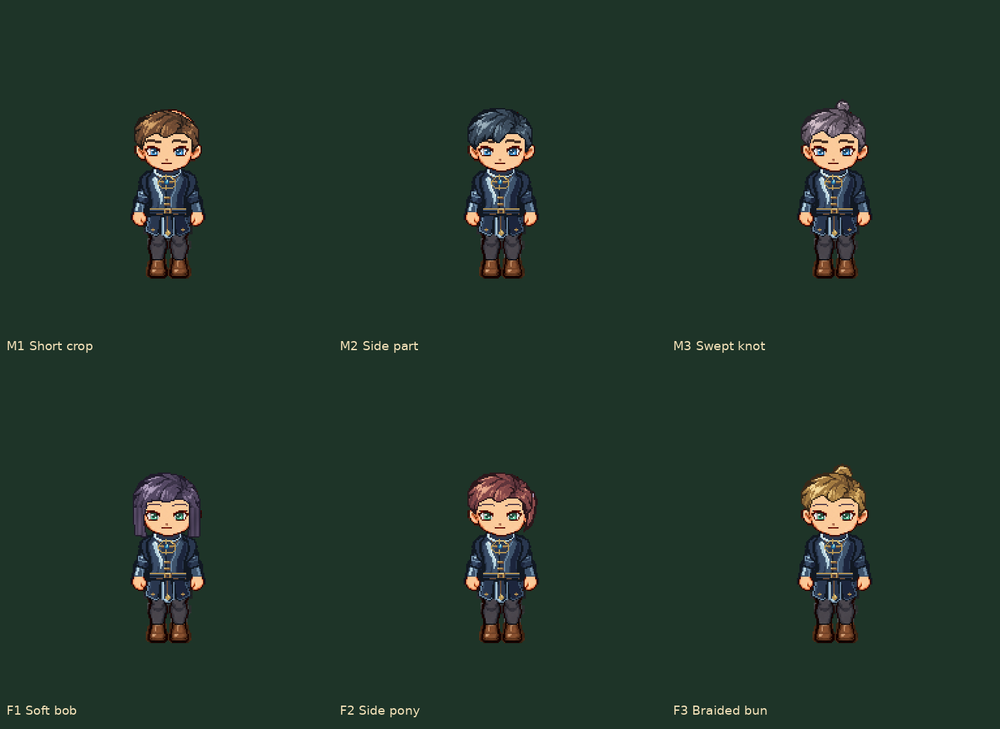

# 双 B 战斗服装与自定义头部 · 2026-11-08

**紫发F1最新修订：** [r3偏分层次短发与正常GIF](../../Review/P1/purple-bob-r3/README.md)；其他五款仍以r2为准。本页旧图按原提交保留历史。

**最新侧面发量：** [r2同步审核](../../Review/P1/side-hair-coverage-r2/README.md)。本页旧图/校验保留原时点事实，当前30张头发PNG已更新。

**2026-11-08 同步修订：** 当前行走/战斗必须共用同一发型、五官和衣服选择。请优先看 [同步批量审核页](../../Review/Battle/appearance-synchronized-v1/README.md) 与 [并排正常GIF](../../Review/Battle/appearance-synchronized-v1/walking-battle-same-head-normal.gif)。下方旧战斗总览为首轮服装审核证据，头部不是当前展示组合；新资源仍未接入App UI/存档。

本轮按用户“可以，把战斗阶段的也做了。然后做几个人物自定义发型（区分男女）和五官”制作。参考固定源 `1f76bce38fb33742ff6eeaef1499c186f14c0fb6`。主线程亲自制作、返修与审核，无智能体代修。当前是可挂载分层资源和离线审核交付，尚未替换 App/课堂图集、外观选择 UI 或人物存档字段；新资源的用户认可仍待反馈。

## 一次批量看图

- [两套衣服 × 四武器：正常攻击 GIF](../../Review/Battle/chat-apparel-b-v1/both-armors-attack-normal.gif)
- [防御、受击、胜利、倒地与起身：正常 GIF](../../Review/Battle/chat-apparel-b-v1/both-armors-states-normal.gif)
- [六种新头部：持弓正常 GIF](../../Review/P1/custom-heads-v1/six-heads-bow-normal.gif)
- [六种发型全身总览 2×](../../Review/P1/custom-heads-v1/six-style-roster-2x.png)
- [四套五官放在相同男/女发型上比较 2×](../../Review/P1/custom-heads-v1/four-face-sets-whole-body-2x.png)
- [发型八向行走与更多全身表](../../Review/P1/custom-heads-v1/README.md)
- [每件战斗服全部动作的 1× / 2× 表](../../Review/Battle/chat-apparel-b-v1/README.md)

## 资源内容与接入约束

两件衣服沿用所选 B：星辉甲·天仪礼甲、龙纹甲·龙翼巡游甲。通用战斗分出贴身衣身、近侧肩甲、上臂袖、前臂袖和前后短护裙；原身体、两手、武器和动作不改。弓使用已认可的 native 分层和原 345 帧绑定，在衣物材质区域换装，保留原轮廓与手腕连接，使用收短贴身版本，不把通用手臂覆盖到弓姿势上。当前是既有向右战斗视角，不声称另画八向战斗。

三款男式：M1 短碎、M2 侧分、M3 小束发；三款女式：F1 短鲍伯、F2 侧束短马尾、F3 盘发。四套五官：MA 明朗蓝瞳、MB 沉静琥珀瞳、FA 柔和绿瞳、FB 清晰紫瞳；眉形、眼睑/眼尾和嘴部色调有细小区别，鼻口保留原人物比例。发型/五官独立混搭，性别标签是样式推荐，不限制组合，也不是新女体。

[头部资源](../../Parts/P1-v1/custom-heads-v1/) 每项 96×96 head-local，八个方向 SVG 母版；发型单独 hair.front，五官分 eyes/brows/nose/mouth。每项104个原动作绑定共用八向母版，无须逐帧重画。每项附色板与登记，背面五官真透明。当前原 motion 的部分方向无 hair.back，因此选择短发/紧凑束发，不隐式扩展长发合同。

[战斗服装](../../Parts/P1-Battle/chat-apparel-b-v1/) 有独立 battle-manifest.json：通用六层 + 弓原 atlas/torso，不拿行走 asset.json 冒充战斗清单。头部各项 battle/ 登记到 256 画布，五官依据原战斗眼鼻口单独固定注册，整体只跟随同一个原头身变换；native 弓对新的局部头部只应用一次 torso 变换，不重复变换已烘焙头图。

接入需按 [课堂美术同步协议](../../../docs/integration/classroom-art-sync.md)，固定本轮真实发布提交，再分别适配行走 catalog、通用战斗部件与 native 弓材质；不能仅复制 PNG 就声称外观选择、存档和课堂已更新。保留6学生+老师、权限/公开画面、规则、存档与随机地图。武器仍取实际装备。制作脚本只输出 Art，不自动改 Sources 或 Vendor。

## 复查与重导

`python scripts/build-chat-apparel-b-battle.py` 重建战斗服与审核；`python scripts/build-custom-heads-v1.py` 重建头部、八向 GIF 与战斗头部；`python scripts/review-custom-heads-and-battle.py` 复核。完整检出固定参考源及 input-manifest.json 的原文件；本地只读参考缓存是下载优化，不是新素材。依赖沿用 Pillow、NumPy、SciPy、Inkscape、jsonschema。

[verification.json](verification.json)：10项头部合同、1040绑定，48种发型/脸/衣服组合×104姿态=4992整人合成；226张资源 PNG 的 RGBA/尺寸/真透明 RGB 检查；两套弓 atlas 非衣物像素/alpha/345帧原绑定保留；91项原输入核对 Git blob；9只正常 GIF 共353实际帧完整解码。机械检查不替代美术审核。

[主线程检查记录](main-agent-art-review.json) 写明已看的全身表和抽取的实际 GIF 接触表，没有把353帧全解码冒充全部逐帧目检。[独立浏览器播放记录](browser-gif-review.json) 只加载四只实际导出的 GIF，12次130ms截图均显示推进；不运行 App/模拟器/实机，不以此声称设备帧率。

两套攻击 GIF 按原演出时间采样2700ms；状态4380ms；新头持弓1720ms；每款八向行走8×120ms=960ms。相同画面由 GIF 合并保留实际停留时长，不加慢放。动态预览不附技能特效，便于看清衣服和两手。

后两步：1. 按本页集中确认/精修战斗服装和头部；2. 按同步协议接入人物自定义、存档及 demo/课堂，完成实际成套图集审核、设备 Release 归档后交直接 IPA。
