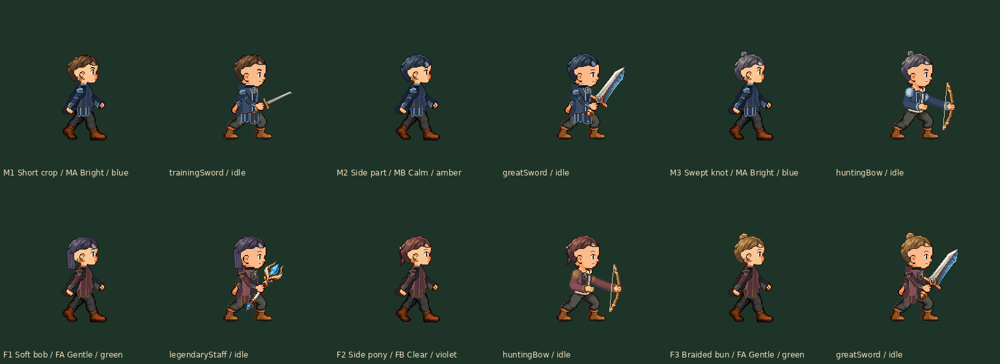

# 行走与战斗：同一发型、同一五官

用户要求“战斗的时候也要把五官和发型同步”。上一轮虽已制作全部头部的战斗注册与单独持弓预览，战斗服装总览仍以旧默认头部导出。这次将权威预览改为读取同一份逐玩家外观记录；旧页保留为历史，不再用它判断新头部是否同步。

每组左边行走、右边战斗。六组同时包含全部六款发型、四套五官、两件衣服和四种武器。两边读取同一个玩家的 outfit/hair/face，近战和 native 弓都不根据性别、职业、武器或数组位置另选头。行走原8×120ms，战斗按原演出时间采样；GIF2700ms，不是慢放。预览不运行游戏。

- [并排正常GIF直链](walking-battle-same-head-normal.gif)
- [并排整身1×](walking-battle-same-head-1x.png) / [2×](walking-battle-same-head-2x.png)
- [两套衣服×四武器：同步新头部的攻击GIF](both-armors-attack-normal.gif)
- [防御/受击/胜利/倒地/起身：同步新头部的GIF](both-armors-states-normal.gif)
- [全部男式发型×四五官，行走/持弓并排](male-all-faces-two-scenes-1x.png)
- [全部女式发型×四五官，行走/持弓并排](female-all-faces-two-scenes-1x.png)
- [男式八阶段全身对照](male-paired-attack-phases-1x.png) / [女式八阶段全身对照](female-paired-attack-phases-1x.png)

本目录另有两件衣服各四武器的 seven-state 1×/2×全身表及实际 GIF 解码接触表。两套战斗总览的默认展示组合来自 scene-bindings.json 的 battleReviewPresets：星辉=M1/MA，龙纹=F1/FA；这是审核样例，不限制实际交叉搭配。

## 同步合同

[scene-bindings.json](../../../Integration/Appearance-battle-custom-heads-v1/scene-bindings.json) 将同一稳定 hair/face ID 同时映射到行走 asset.json 和战斗独立部件。outfit 同理；原身体、动作、手和武器不改。`scripts/appearance-scene-binding.py` 的不可变 Appearance(outfit,hair,face) 是两场景共用的完整选择；`set_player` 验证完整新配置后替换，失败保留原配置，不借用其他玩家或默认头部。`walking_parts` 与 `Renderer.for_appearance` 从同一选择解析，缺发型/脸时拒绝，不允许只换一层又叠旧头部。

此处是离线资源装配合同与预览实现。App 的外观选择、人物存档和课堂公开/教师界面还未接入这些新ID；不把此次修改称为安装包里的已生效功能。接入时必须在同一人物档案保存这三个字段，探索/战斗都读取它，不新建战斗专用外观；保留原课堂权限、组队、存档与规则。旧档默认迁移须在真实接入阶段明确实现，不在美术预览中静默替换。新美术用户认可仍待反馈。

## 检查与重导

`sync-verification.json` 记录48组合（6发×4脸×2衣）×4武器×7状态×3阶段=4032战斗整人合成，另144行走全身。实际对比两张装入的 battle head PNG 与对应选择，验证独立换脸不改变发型/其他玩家、非法脸保留原选择、未知玩家拒绝。`unchanged-art-inputs.json` 核对226张原头部/衣物PNG均与首轮美术源3ef48ebdb43d608d459fc438714fe0f6e1ed6d29逐字节一致；本轮不重画人体、手或头部，不改变注册位置。

主线程亲自看整身两场景对照、男/女全部脸组合、两张八阶段对照，另看龙纹持弓/星辉重剑七状态表和实际并排GIF抽帧。其余机械合成与全GIF解码不冒称逐张人工目检。`browser-gif-review.json` 只用独立Chromium加载三个真实GIF并定时截帧，不是App/模拟器/实机执行或性能测量。

完整参考检出中重导：先按上一轮说明生成服装和头部（现有已生成226PNG无需重画），然后执行 `python scripts/build-chat-apparel-b-battle.py` 输出本目录同步头部总览，再 `python scripts/review-synchronized-appearance.py` 复核并生成并排展示。后续 `build-custom-heads-v1.py` 重导的默认行走/持弓样例也统一使用 scene-bindings 的选择，不各自按性别猜默认脸。

后两步：1. 集中确认/精修这批服装和头部；2. 将同一外观记录接入人物自定义/存档和探索/战斗渲染，再按课堂同步协议归档直接IPA。
