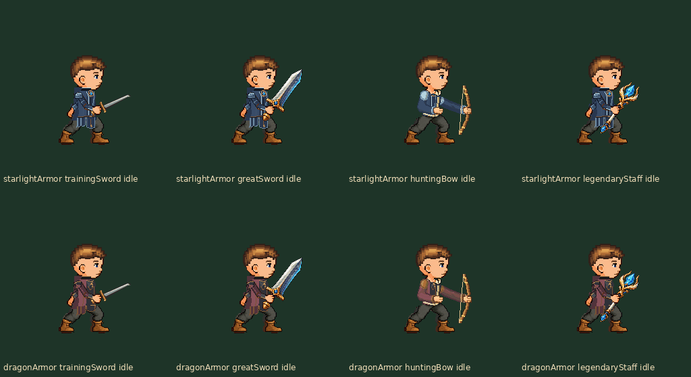

# 双 B 战斗服装批量审核

沿用原人物/双手/武器/四套动作，不重画整人。星辉甲 B 天仪礼甲与龙纹甲 B 龙翼巡游甲的新分层资源在 Art/Parts/P1-Battle/chat-apparel-b-v1；当前尚未导入 App，用户认可待反馈。

[攻击直接 GIF](both-armors-attack-normal.gif) · [防御/受击/胜利/倒地/起身正常 GIF](both-armors-states-normal.gif)

| 武器 | 星辉甲 | 龙纹甲 |
| --- | --- | --- |
| 剑 | [1×](starlightArmor-trainingSword-states-1x.png) / [2×](starlightArmor-trainingSword-states-2x.png) | [1×](dragonArmor-trainingSword-states-1x.png) / [2×](dragonArmor-trainingSword-states-2x.png) |
| 重剑 | [1×](starlightArmor-greatSword-states-1x.png) / [2×](starlightArmor-greatSword-states-2x.png) | [1×](dragonArmor-greatSword-states-1x.png) / [2×](dragonArmor-greatSword-states-2x.png) |
| 猎弓 | [1×](starlightArmor-huntingBow-states-1x.png) / [2×](starlightArmor-huntingBow-states-2x.png) | [1×](dragonArmor-huntingBow-states-1x.png) / [2×](dragonArmor-huntingBow-states-2x.png) |
| 法杖 | [1×](starlightArmor-legendaryStaff-states-1x.png) / [2×](starlightArmor-legendaryStaff-states-2x.png) | [1×](dragonArmor-legendaryStaff-states-1x.png) / [2×](dragonArmor-legendaryStaff-states-2x.png) |

每表七行依次 idle / attack / guard / hit / victory / defeat / revive，每行五阶段。revive 复用原倒地反向，不新做骨骼；GIF 中保留原节奏，duplicate 画面合并后停留时长不变。decoded/ 是实际 GIF 解码接触表；全解码不等于每张都逐一目检，见 [统一交付/检查记录](../../../Integration/Appearance-battle-custom-heads-v1/README.md)。
