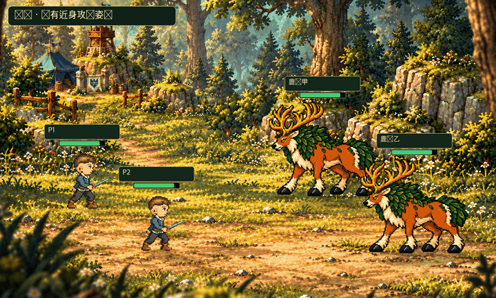

# 五套战斗技能特效 · Build 71 候选

以下为全场景正常速度离线合成动图（720×432，每段 2.8 秒）。人物／怪物只使用项目现有攻击或防护动作，未制作新动作；范围特效只在目标节点播放一次。GIF用于美术审核，不是 UIKit、模拟器或实机录屏。

- 星辉脉冲：现有远程攻击动作，目标敌方节点。
- 振奋：现有防护动作，目标友方节点；取代旧矢量替代效果。
- 横扫：洞穴巨魔现有近身攻击动作，目标同节点玩家。
- 龙魂庇护、龙鳞庇护：现有防护动作，目标友方节点。

## 星辉脉冲

## 振奋

## 横扫

## 龙魂庇护

## 龙鳞庇护

逐帧时间线与审核元数据见 [`review.json`](review.json)。原始 ZIP、交付说明、源图集和拆帧均保存在 `Art/Parts/BattleVFX/`；像素未改动。