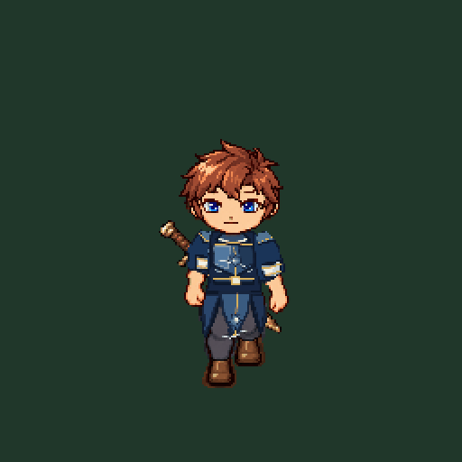
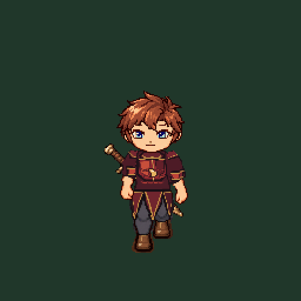

# B5 星辉甲与龙纹甲：八向服装候选

本目录是两套新盔甲的批量审核资料；美术认可状态为空，用户可先看下面的正常速度GIF。预览为真实离线装配结果，不是App或设备录屏。

本轮按已认可的 P1 行走外观标准制作装备清单剩余两套护甲：`starlightArmor` 星辉甲和 `dragonArmor` 龙纹甲。每套都是可独立选择的上身服装资源，逐方向覆盖 `idle`、八帧行走、两帧起步、两帧收步，共104条绑定、416张RGBA部件图。沿用当前身体、裤靴、关节、逐帧遮挡、注册坐标与动作时序；没有修改运行时代码、原人体或原服装。

星辉甲采用深靛蓝金属、冷银护臂与星芒胸饰，配三片分开的短甲裙；龙纹甲采用酒红鳞片甲、古铜边、分层肩甲与独立分片的护腰。两套都保留当前棕发／银发、蓝眼／琥珀眼、背剑／空背组合。裤靴复用现有 `p1-eight-way-lower-v1`，不复制或重画人体。

## 先看动图

下列 GIF 使用当前合成器的整身输出，包含默认背剑，循环8帧×120 ms。它们是美术审核预览，不是设备录屏。

| 外观 | 正下正常步行 | 正下起步—行走—收步 | 八方向正常步行 |
| --- | --- | --- | --- |
| 星辉甲 | [GIF](preview/p1-b5-starlight-armor-v1/down-walk-normal.gif) | [GIF](preview/p1-b5-starlight-armor-v1/down-start-stop-normal.gif) | [下](preview/p1-b5-starlight-armor-v1/down-walk-normal.gif) · [左下](preview/p1-b5-starlight-armor-v1/down-left-walk-normal.gif) · [左](preview/p1-b5-starlight-armor-v1/left-walk-normal.gif) · [左上](preview/p1-b5-starlight-armor-v1/up-left-walk-normal.gif) · [上](preview/p1-b5-starlight-armor-v1/up-walk-normal.gif) · [右上](preview/p1-b5-starlight-armor-v1/up-right-walk-normal.gif) · [右](preview/p1-b5-starlight-armor-v1/right-walk-normal.gif) · [右下](preview/p1-b5-starlight-armor-v1/down-right-walk-normal.gif) |
| 龙纹甲 | [GIF](preview/p1-b5-dragon-armor-v1/down-walk-normal.gif) | [GIF](preview/p1-b5-dragon-armor-v1/down-start-stop-normal.gif) | [下](preview/p1-b5-dragon-armor-v1/down-walk-normal.gif) · [左下](preview/p1-b5-dragon-armor-v1/down-left-walk-normal.gif) · [左](preview/p1-b5-dragon-armor-v1/left-walk-normal.gif) · [左上](preview/p1-b5-dragon-armor-v1/up-left-walk-normal.gif) · [上](preview/p1-b5-dragon-armor-v1/up-walk-normal.gif) · [右上](preview/p1-b5-dragon-armor-v1/up-right-walk-normal.gif) · [右](preview/p1-b5-dragon-armor-v1/right-walk-normal.gif) · [右下](preview/p1-b5-dragon-armor-v1/down-right-walk-normal.gif) |

下方先放两套的正下正常速度循环；表中链接可直接打开其余七向，不用停在目录页找文件。

动图节奏遵循既有标准：步行8帧×120 ms＝960 ms；起停共22帧，首尾站姿各480 ms，中间20帧各120 ms，总长3360 ms。逐GIF解码、循环及像素轮廓比较见 [gif-audit.json](gif-audit.json)。

## 资源与复核

- [星辉甲104绑定资源](../../../Parts/P1-v1/b5-set-armors-v1/starlightArmor/asset.json) · [星辉甲可编辑五视角SVG](../../../Parts/P1-v1/b5-set-armors-v1/starlightArmor/editable/armor-design.svg)
- [龙纹甲104绑定资源](../../../Parts/P1-v1/b5-set-armors-v1/dragonArmor/asset.json) · [龙纹甲可编辑五视角SVG](../../../Parts/P1-v1/b5-set-armors-v1/dragonArmor/editable/armor-design.svg)
- [审核catalog](catalog.json) · [完整组合实际装配记录](combination-composition.json) · [两发型/两五官/背剑开关整身矩阵](compatibility-matrix.json)
- [正下站姿1×/2×与全部当前姿势1×/2×](preview/p1-b5-starlight-armor-v1/) · [龙纹甲姿势页](preview/p1-b5-dragon-armor-v1/)
- [审核说明](art-review.md) · [技术及人工核验](verification.json) · [认可状态](user-approval-profile.json) · [公开链接核验回执](delivery.json)

机器检查通过：`scripts/check-character-part.py` 分别检查两套新manifest。审核catalog中，以每套新甲搭配2种发型、2种五官、空背/背剑共8个loadout；两套共16组、实际合成1664个整身姿势。根线程亲自复看两套的各方向和全部13姿势1×/2×页面，另检查实际解码正常行走GIF和兼容矩阵。

**范围状态：** 当前交付完成八向行走外观资源，不包含Battle rig的攻击/格挡/受击等战斗挂载层，也不表示星辉/龙纹套装物品已加入营地运行界面。美术认可仍为 `null`，等用户查看本页动图/页面后再按实际反馈记录；不能把皮甲、符文甲的局部审核认可扩大到这两套。
