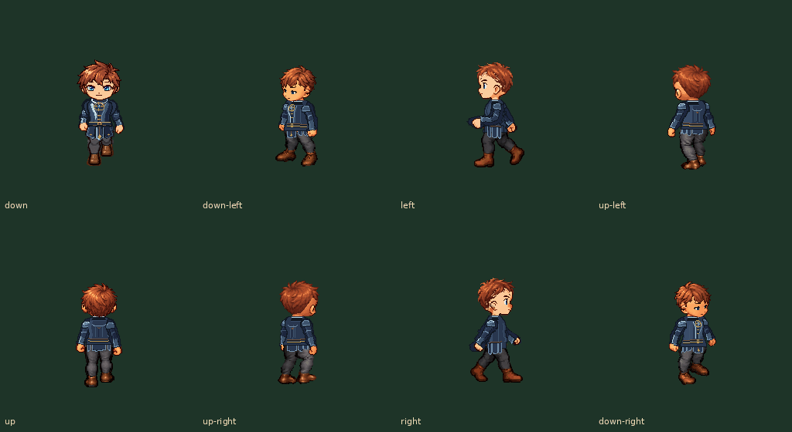
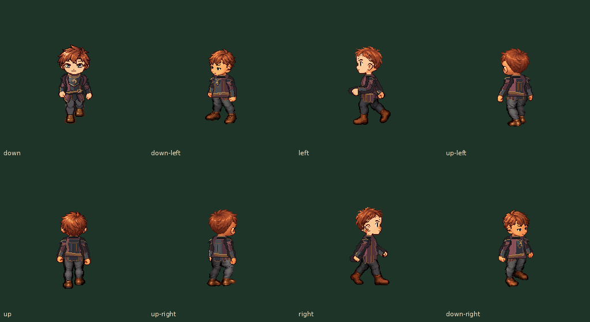

# 星辉甲 B / 龙纹甲 B：八向服装候选

用户于2026-11-07选择两套B，并要求“一路做完所有方向”。本轮完成全部八向的静态分层母版、原行走模组适配、站立/行走/起停和主线程离线审核。两套分别为**星辉甲·天仪礼甲**与**龙纹甲·龙翼巡游甲**。

## 直接看正常速度动图

| 资源 | 八向行走 | 原背剑遮挡 | 站姿 |
| --- | --- | --- | --- |
| 星辉甲 B | [正常GIF](starlightArmor/eight-way-walk-normal.gif) | [正常背剑GIF](starlightArmor/eight-way-back-sword-normal.gif) | [1×](starlightArmor/all-directions-standing-1x.png) / [2×](starlightArmor/all-directions-standing-2x.png) |
| 龙纹甲 B | [正常GIF](dragonArmor/eight-way-walk-normal.gif) | [正常背剑GIF](dragonArmor/eight-way-back-sword-normal.gif) | [1×](dragonArmor/all-directions-standing-1x.png) / [2×](dragonArmor/all-directions-standing-2x.png) |

每件目录另有八只 `<direction>-walk-normal.gif`、八只 `<direction>-start-stop-normal.gif`，以及每向13姿势的1×/2×全身表。八帧行走沿用120ms/帧，未拉慢、插重复帧或改原步相；起停使用原入口/出口。

## 实际文件与适配

- [星辉甲资源](../../../Parts/P1-v1/chat-apparel-v2/starlightArmor/) / [龙纹甲资源](../../../Parts/P1-v1/chat-apparel-v2/dragonArmor/)。每件 `masters/<view>/` 八个静态view，各四张256×256 RGBA真透明PNG，共32；两件64。默认五view之外的三个右向有各自几何源稿和固定左上光，不是直接翻PNG就称完成。
- 每件 `editable/<view>.svg` 是四个独立语义组的真实几何源，无整人嵌图；肩甲属于对应袖组。`source/` 含色板、sRGB配置与制作说明。`master-manifest.json` 登记母版，`asset.json` 则是原模组104姿势、四衣物槽的实际绑定；不能把两种清单互换。
- 每件 `png/<direction>/<clip>/<frame>/` 共416层，两件832。原motion、身体/头脸/手/裤靴/背剑、骨骼及drawOrder不改。母版登记后通过既有 `armor-shared-surface-r4.py` 生成动作；内衬按原语义身体轮廓补足，甲片沿原运动场变形。合成使用原 `compose-character-parts.py` 顺序，头和手最后绘制。
- 正面结构来自所选B，已落到项目原画布重新制作，不从1536概念板切出衣服；非正面独立表达胸/侧/背，背部不重复正面徽记。未制作新人物或战斗动作。

重导：在完整参考检出中安装已有脚本所需的Pillow、NumPy、SciPy、jsonschema及Inkscape，然后执行 `python scripts/build-chat-apparel-b-eight-way.py`。`--masters-only` 仅母版，`--poses-only` 复用已有母版，`--reviews-only` 复用已有动作层。front脚本仅为正面几何作者模块。复核执行 `python scripts/review-chat-apparel-b.py`（先完整取得 input-manifest.json 指定的2392原层）；它验证实际文件/组合并重新解码GIF，不能替代主线程视觉审核。只读参考固定于 `615c229737ed3f4381b47a860ae8069854fba634`。

## 检查与返修范围

主线程检查了每件全部八向13姿势的1×全身、八向站姿2×及侧向动作2×；四只八向总览/背剑GIF全部32实际解码帧也逐页查看，见 `decoded-gif-review/`。检查肩腋肘腕、胸腹服帖、短护裙与髋腿、首尾08→01、原起停入口、远侧阴影及背剑。

先后返修侧面底衣露出、后斜上臂缺布、侧面远臂摆动露肤；原参考里远处alpha=1插值哨兵不能被内衬生成器放大为实心色点。现在只用语义人体轮廓定位服装，不取其皮肤RGB，不更改原人体；没有按肤色或最大连通域粗删新衣物边缘。

[verification.json](verification.json) 记录64母版/832动作层的PNG、RGBA、ICC、透明RGB及绑定覆盖；2发型×2五官×背剑开关共1664合成；36GIF全部512帧解码和时长。原2392参考PNG逐一匹配Git blob SHA，原motion SHA保持。八向母版和新运行资源都经原合同检查。

[浏览器推进记录](browser-gif-review.json) 为独立Chromium加载本地HTTP实际GIF，8次130ms截图证明动画推进；不是App截图、触摸回放或实机性能数据。`gif-playback.html` 仅是本地GIF查看器。主线程未运行App/模拟器/实机，也未使用子智能体。

## 状态与后两步

**已完成本轮离线八向资源与审核候选；用户只认可所选B设计方向，新像素资源/动作的认可仍为null。** 尚未替换App图集或课堂资源基线，本轮没有新IPA，也不冒称游戏中已经能选用。旧资源与历史候选保留。

1. 按本页一次审核两件全部方向，集中精修用户指出的问题。
2. 认可后按 `docs/integration/classroom-art-sync.md` 接入demo/课堂，核对成套图集与实际设备Release包，再交直接IPA。
