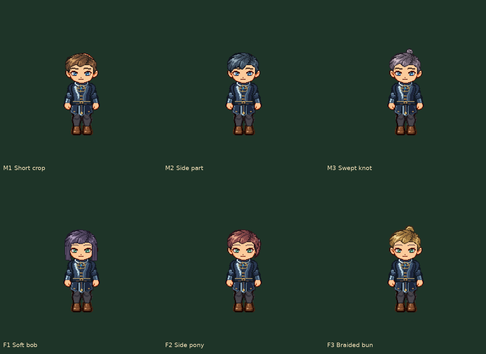
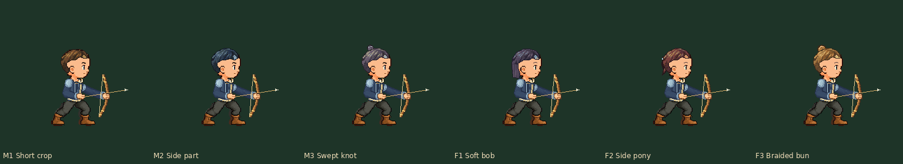

# 自定义发型与五官 · 批量审核

**当前紫发以原正面盖耳为准：** [r4双侧/战斗一致性修正](../purple-ear-cover-r4/README.md)。r3整体剪短属于误解，已撤回；本页旧图保留原提交历史。

**紫发F1最新修订：** [r3偏分层次短发与正常GIF](../purple-bob-r3/README.md)；其他五款仍以r2为准。本页旧图按原提交保留历史。

**最新侧面发量：** [r2同步审核](../side-hair-coverage-r2/README.md)。本页旧图/校验保留原时点事实，当前30张头发PNG已更新。

**当前同步预览：** 请看 [同一外观的行走/战斗对照](../../Battle/appearance-synchronized-v1/README.md)。本页保留首轮资源与预览记录。

三款男式、三款女式与四套独立五官。复用同一身体/骨骼，性别仅样式推荐，可任意交叉组合；不是新女体或已发布的游戏换装 UI。整个人物比例为主要验收尺度，不只放大脸。

| 发型 | 样式 | 行走 |
| --- | --- | --- |
| M1 Short crop | 男式 | [八向正常GIF](m1-short-eight-way-normal.gif) |
| M2 Side part | 男式 | [八向正常GIF](m2-sidepart-eight-way-normal.gif) |
| M3 Swept knot | 男式 | [八向正常GIF](m3-topknot-eight-way-normal.gif) |
| F1 Soft bob | 女式 | [八向正常GIF](f1-bob-eight-way-normal.gif) |
| F2 Side pony | 女式 | [八向正常GIF](f2-ponytail-eight-way-normal.gif) |
| F3 Braided bun | 女式 | [八向正常GIF](f3-bun-eight-way-normal.gif) |

[四套五官全身比较](four-face-sets-whole-body-2x.png) · [战斗头部静态](battle-head-registration-1x.png) · [六种头部持弓正常GIF](six-heads-bow-normal.gif)

全八向+全六款发型固定同一五官：

- [MA 明朗蓝瞳](all-hair-m1-bright-whole-body-1x.png)
- [MB 沉静琥珀瞳](all-hair-m2-calm-whole-body-1x.png)
- [FA 柔和绿瞳](all-hair-f1-gentle-whole-body-1x.png)
- [FB 清晰紫瞳](all-hair-f2-clear-whole-body-1x.png)

[统一交付与检查记录](../../../Integration/Appearance-battle-custom-heads-v1/README.md)；[真实分层母版/色板/绑定](../../../Parts/P1-v1/custom-heads-v1/)。新资源用户认可仍null，当前离线资产交付，未改游戏UI、存档或App版本。
