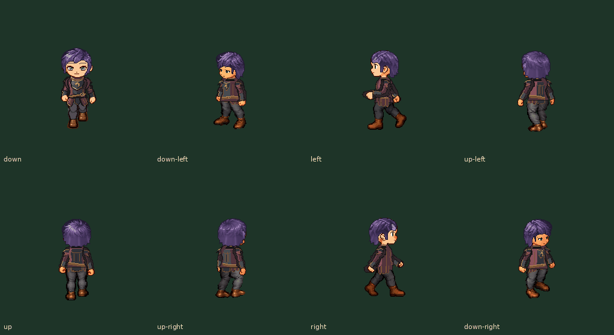

# 紫发 F1：偏分层次短发 r3

**当前紫发以原正面盖耳为准：** [r4双侧/战斗一致性修正](../purple-ear-cover-r4/README.md)。r3整体剪短属于误解，已撤回；本页旧图保留原提交历史。

用户指出紫发款仍然不好看。本轮只重做原 F1 短鲍伯：齐厚的帘状轮廓改为偏分刘海，侧边收出耳朵和细发束，后颈变短、发尾错落；背面直条发纹改为较宽的弯曲发束，紫色略提清晰度。稳定ID p1-custom-hair-f1-bob-v1 保持，版本1.0.2。其他五款发型、四套五官、衣物、身体和动作不改。

[八向正常GIF直链](purple-eight-way-normal.gif) · [行走/四武器同步正常GIF](purple-walk-battle-normal.gif)

[修改前后八向全身1×](before-after-eight-directions-1x.png) / [2×](before-after-eight-directions-2x.png)：第一、三行为旧版，第二、四行为r3；同一身体、同一蓝衣和五官，不能用改脸或改身体来冒充发型改进。

[两套衣服与战斗站姿1×](standing-and-battle-1x.png) / [2×](standing-and-battle-2x.png) · [蓝衣七状态](battle-states-1-1x.png) · [龙纹衣七状态](battle-states-2-1x.png)

## 检查与复用

仅九张头发PNG更新：八个96局部母版与一张256战斗头发；原头部注册、眼鼻口和耳朵不动。217张其他头部/战斗衣物PNG逐字节保持，见 input-pngs.json / verification.json。原motion SHA保持。发型仍是独立 hair.front，未引入新身体、长发后层或按武器选择不同头部。

八向合同、四套实际眼像素避让、透明RGB和单一连通轮廓检查通过；初稿正面两边碰到外眼角，主线程已收回发梢修正，没有删眼睛或放宽保护检查。四套脸×两衣×104行走=832整人合成，四武器×七状态×三阶段共672战斗姿态通过。两只正常GIF分别8×120ms和2700ms，完整93实际帧解码。

主线程亲自查看1×/2×八向修改前后、战斗全身站姿、龙纹衣七状态及实际GIF中间帧。机械全覆盖不冒称全部逐帧目检。browser-gif-review.json为独立浏览器真实GIF推进，不是App/模拟器/实机或性能测试。

重导：python scripts/build-custom-heads-v1.py 从当前几何/色板重建；python scripts/review-purple-bob-r3.py 做本轮复核。修改前对照基线为42df0a0a3c2b15f8e67bf3787d47e7d8ae6564f5。新增发型版本继续与同一人物选择一起传给行走与战斗，不改头部平移来掩盖轮廓问题。

当前仍为资源审核修订，App外观选择、人物存档和安装包尚未更新。主线程制作与审核，无子智能体，新美术用户认可待反馈。后两步：集中精修剩余外观反馈；接入人物自定义/存档与探索/战斗，再归档直接IPA。
