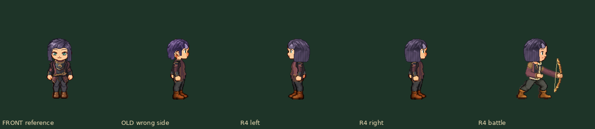
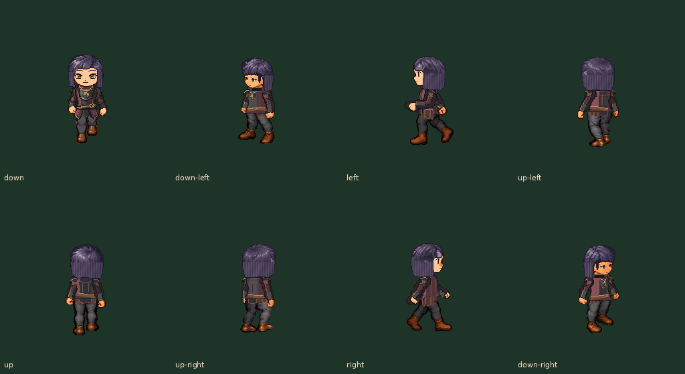

# 紫发正侧面：与正面盖耳发型一致 r4

用户指出正面是盖耳的长发，侧面却变成露耳短发；随后更正范围为所有正侧面，覆盖行走正左/正右和现有战斗侧视。上轮r3把整款改成短发是范围误解，本轮撤回那次整体改造。

以修改前42df0a0a3c2b15f8e67bf3787d47e7d8ae6564f5的正面为基准，恢复其正面、两个斜下与三个后向原稿，六视角SVG/PNG逐字节一致；只对正左/正右新画盖耳发束，并同步原正右战斗挂载。原色板恢复，不另设计刘海或剪短后脑。稳定ID保持，版本1.0.3。

[全身对照1×](front-side-battle-1x.png) / [2×](front-side-battle-2x.png)：从左到右为原正面、错误的r3短侧面、修正左、修正右、修正战斗。

[八向正常动图直链](ear-cover-eight-way-normal.gif) · [行走/四武器正常动图](ear-cover-walk-battle-normal.gif) · [两衣装全身战斗2×](standing-and-battle-2x.png)

[八向修正前后1×](before-after-eight-directions-1x.png) / [2×](before-after-eight-directions-2x.png)；其中OLD short为撤回的r3，不是用户指定的正面基准。

## 复核与交接

六个非正侧视角的PNG/SVG与用户指出的原正面系列基线逐字节一致，见 verification.json 的sixReferenceViewsByteExact。两正侧面耳部核心框各204像素均被头发覆盖，修前仅57/56；战斗耳区也覆盖。四套实际眼睛在正侧面零交叠，未删改耳朵、皮肤、眼鼻口或人体。长发材质从正面延续到侧面，避免将耳区填成暗色补丁。

其他五发型、四五官与战斗衣物等217PNG逐字节保持。四脸×两衣×104原行走=832整人姿态；四武器/七状态/三阶段共672战斗姿态复查。原motion及头部注册保持，bow新头只跟一次torso；不是新绘动作。两只正常GIF完整93实际帧，行走8×120ms，战斗2700ms。主线程亲自看正面/双侧/战斗整身2×、实际GIF中间帧与龙纹衣七状态；机械全覆盖不算逐张目检。独立浏览器仅查GIF推进，不是App/设备性能测试。

重导作者源：python scripts/build-custom-heads-v1.py；本轮检查：python scripts/review-purple-ear-cover-r4.py。参考基线42df0a0a3c2b15f8e67bf3787d47e7d8ae6564f5，修改前对照71a6aaa38d0e39ca1d96ba4133eb8c7fea9abe0f。改侧面一致性时，必须先以正面发长/盖耳关系作约束，不自行改整款前后视设计。

本轮仍为分层资源审核，尚未接入App外观UI、人物存档或新安装包。无子智能体，不运行App/模拟器/实机，新美术认可待反馈。后两步：集中精修外观反馈；同一人物选择接入自定义/存档与探索/战斗，再设备归档交直接IPA。
