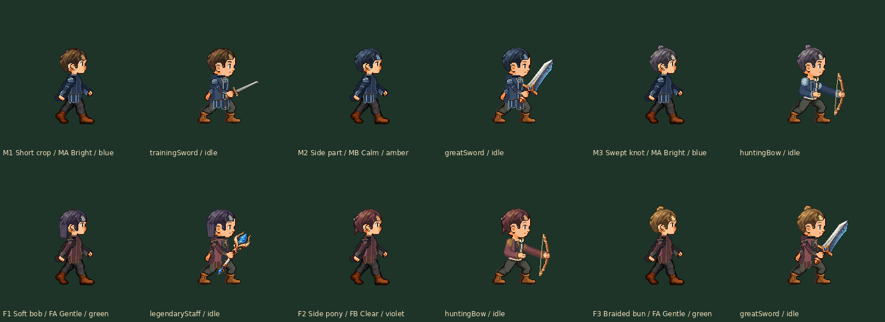

# 侧面发量覆盖 r2

**当前紫发以原正面盖耳为准：** [r4双侧/战斗一致性修正](../purple-ear-cover-r4/README.md)。r3整体剪短属于误解，已撤回；本页旧图保留原提交历史。

**紫发F1最新修订：** [r3偏分层次短发与正常GIF](../purple-bob-r3/README.md)；其他五款仍以r2为准。本页旧图按原提交保留历史。

六款发型降低左右侧面发际线，补耳上发量与耳前鬓发；两个斜下方向同步过渡。五官、耳朵、皮肤、身体、衣物和动作不改。稳定ID保持，hair版本1.0.1；行走/战斗共用同一外观配置。

[正常GIF直链](walking-battle-same-head-normal.gif) · [全身1×](walking-battle-same-head-1x.png) / [2×](walking-battle-same-head-2x.png)

[修改前后全身1×](side-before-after-whole-body-1x.png) / [2×](side-before-after-whole-body-2x.png)：每行旧行走、新行走、旧持弓、新持弓。旧素材来自修改前 ec0cf30811054c1e883841894914afdb43c07593。

[正左](left-all-six-whole-body-1x.png) · [正右](right-all-six-whole-body-1x.png) · [左下](down-left-all-six-whole-body-1x.png) · [右下](down-right-all-six-whole-body-1x.png)

[四武器攻击GIF](both-armors-attack-normal.gif) · [防御至起身GIF](both-armors-states-normal.gif)

各款八向正常GIF： [男短碎](m1-short-eight-way-normal.gif) · [男侧分](m2-sidepart-eight-way-normal.gif) · [男小束发](m3-topknot-eight-way-normal.gif) · [女短鲍伯](f1-bob-eight-way-normal.gif) · [女短马尾](f2-ponytail-eight-way-normal.gif) · [女盘发](f3-bun-eight-way-normal.gif)

只修改24张四向96母版及六张256战斗头发。正面和三个后向24张头发逐字节保持，其他196张头部/衣服PNG保持。短鲍伯斜左初稿曾进入眼保护区，已收回发束；不放宽合同，六项合同和四套实际眼像素零相交通过，见 coverage-verification.json。

48种发型/脸/衣服组合重新检查4032战斗姿态和144行走全身。9只GIF全部解码，行走8×120ms；主GIF2700/2700/4380ms，不慢放。browser-gif-review.json 仅证明五只真实GIF在独立浏览器推进，不是App或设备性能测试。

本地主要整身审核完成后，执行环境断连。本次从相同几何源在GitHub重新生成，实际交付以本轮发布源与回执为准；没有把本地未上传图冒称公开交付。重建后的实际图须由主线程再次打开检查，审查记录随交付收尾保存。

重导：完整参考检出执行 python scripts/build-custom-heads-v1.py；随后 python scripts/review-side-hair-coverage.py。修改前对照需要本地ec0cf308的Git对象；禁止无控制懒取大仓库。当前是资源审核修订，App外观UI/人物存档尚未接入，不更新安装包版本或运行App/模拟器/实机。新美术认可待反馈。

后两步：集中精修外观反馈；按同一人物选择接入自定义/存档与探索/战斗，再归档直接IPA。

主线程已再次打开本次重建的实际整身对照、四个修订方向与GIF抽帧，见 [实际复核记录](main-agent-art-review.json)。机械全覆盖未冒称全部逐张目检。
