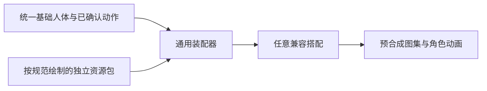

# P1 可复用换装美术标准 v1 · 制作合同草案

目标：美术按同一基础人体和动作模板交付资源包，装配器读取资源包即可替换外观；新增资源不修改动作、不为资源名称增加代码分支，也不依赖另一件外观才能正常显示。

**当前状态：用户已认可v8展示的向下全身外观与正常120ms行走循环，见[认可记录](../../Templates/P1-Wardrobe/down/v8-back-carry/approval.json)。** v7判退及此前内部结论撤回记录保留。其他未展示组合、方向、起停过渡和App接入不在此次认可范围。当前新增[v9第二衣型](../../Templates/P1-Wardrobe/down/v9-second-outfit/README.md)候选，蓝色长外套与绿色短上衣共享人体、原动作和装配器，内部36组合/324姿势检查完成，展示的蓝外套外观及正常循环也已获用户认可；向左r3展示与指定起停路径已获限定认可，向左独立外观v1被用户判退，主线程已另存v2逐姿势衣物返修候选；本合同仍未locked，完整生产模板尚未完成。

## 当前返修：向左衣物v2

v1已被用户判退，旧内部美术通过撤回。[v2](../../Templates/P1-Wardrobe/left/v2-painted-poses/README.md)由主线程修正描边/镶边提取、裤靴块状拉伸、蓝衣摆硬片和后侧手被衣片覆盖。新三衣物包沿用同一r3身体与动作，原头发/五官/背剑复用；新增外观认可为空，完整生产合同仍未locked。源稿、全身与正常速序列必须由主线程复核，技术覆盖数字和智能体声称完成不构成美术通过。

## 2026-10-22 · 向左外观覆盖与方向复用

[向左独立外观v1](../../Templates/P1-Wardrobe/left/v1-independent/README.md)在原r3身体/13姿势上登记9个独立资源包：三发型、两五官、两上衣、共用裤靴与背剑。72组合/936图、10清单与264文件两轮重导通过，新增外观用户认可为空，人体标准仍未locked。profile.json的headLayouts.left采用当前固定头板实际眼眉鼻口区域，完整保留眼睑/唇线，禁止混入皮肤/耳/下颌。该局部坐标候选不变更原头形或其他方向。

最终八方向覆盖与原始资源的复用是两件事。横版常用左右朝向，俯视游戏可选四或八方向；本项目运动支持八方向，因此组合输出要有八方向。原稿允许对称部分镜像后检查、同向发型/五官复用局部图、刚性背剑多个姿势共图；衣袖/裤腿/衣摆按共同姿势作者变形并导出PNG。非对称发型、衣襟、持物侧和近远遮挡必须逐向复核，不能将镜像等同于已完成。当前采用离线逐帧分层装配，未接入运行时骨骼系统。

## 1. 采用的路线与“挂载”的含义

采用 **固定动作的二维逐帧分层装配**，沿用已认可八方向的相位、比例和步态。动作模块提供逐帧基础人体、关节、挂点和遮挡顺序；外观资源包提供透明部件及适配声明；同一个装配器输出预合成图集，运行时复用动作索引。



“挂载即可使用”指**符合模板的资源包**可以直接装配。头发和五官在同一视角下可以复用局部图；会变形的袖子、衣摆等要按模板提供对应方向／关键帧。整套八方向当前共 72 个姿势映射，允许多帧引用同一张无需变形的图。任意一张衣服图片不会自动获得所有动作。

此路线保留现有逐帧美术。若以后需要大量新增动作、任意体型或连续转身，应另立骨骼／三维模型项目；本合同不把九张二维图描述成已经完成的蒙皮绑定。

## 2. 先锁定唯一的基础人体

| 项目 | 统一要求 |
| --- | --- |
| 动作画布 | 256 × 256，左上为原点；站姿 00，行走 01–08；正常 120 ms／帧 |
| 方向 | down、left、up、right、down-right、down-left、up-left、up-right；不自动镜像代替未制作视角 |
| 基础人体 | 无头发、无五官、完整头皮与耳朵；躯干、上臂、前臂、手、腿脚在遮挡处也画完整；用简单贴身内衫／短裤作为安全底层 |
| 身体一致性 | 所有外观共用同一份人体；禁止因某种头发、眼睛或衣服切换底稿、头形、肤色或身体尺寸 |
| 动作保护 | 原认可素材是动作参照，原文件不变；中性人体另画另审，保持承重、脚距、鞋尖方向与关节相位 |
| 坐标与左右 | 使用角色自身左右；向下时角色右手在画面左边；其他方向按各自标注使用，不猜近远侧 |
| 挂点 | 头部坐标系、颈根、胸、骨盆、肩／肘／腕、左右握持点、髋／膝／踝、鞋底接触分别记录 |
| 遮挡 | 动作模块逐帧规定语义层顺序；手、武器、袖子、衣摆及近远腿单独处理，不能把同一个全局层序套到八方向 |

`profile.json` 定义部件、尺寸与五官区域；`motion-down.draft.json` 已同步向下中性九帧候选的头部、肩肘与关节／握持／足底和身体层序，避免继续沿用旧配套人物坐标。行走已获认可，映射文件保留制作时的候选注记，认可权威见独立 approval.json；完整衣物／武器层序尚待真实美术审核。

[实际公共头板与绘制层](../../Templates/P1-Neutral/down/r1/head-authoring.svg) · [旧动作九帧迁移导板](guides/) · [资源包清单模板](examples/) · [旧方案迁移审查](MIGRATION.md)

原靴子应另存为默认鞋部件，公共腿脚底层补成完整足部，不把旧靴子轮廓烘焙进身体；穿不同鞋时仍使用同一踝关节与足底接触相位。

## 3. 美术部件边界

| 部件 | 应交付 | 禁止混入 |
| --- | --- | --- |
| 发型 | 前发／后发透明层，以标准头型和颈根制作；短发可用头部局部画布，长发可用逐帧全画布 | 脸皮、耳朵、眼睛、眉毛、衣领；禁止为某种眼睛移动刘海或头部挂点 |
| 面部 | 眼睛、眉毛、鼻子、嘴各自透明层，使用同一五官坐标与表情区域 | 肤色底板、额头填色、脸颊、下巴轮廓、耳朵、头发；不能用“换整张脸皮”补发型接缝 |
| 上衣 | 躯干、左右袖子、前后衣摆等按需分层；内部与人体有稳定重叠边，完整覆盖后面的皮肤 | 头部、手掌、裤腿、鞋子；不能只裁旧整人图片再猜颜色来替代独立服装 |
| 下装／靴子 | 按左右腿、靴子和关节接缝分别制作，沿用相位与脚底 | 重画其他肢体；换鞋时重新缩放人物或改变脚距 |
| 武器 | 手持声明局部握点；背负声明独立weapon.back与carryProfile: back-scabbard，按躯干注册并绘在身体后 | 手掌/手臂、按武器切换身体、把背负伪装成手持挂点 |
| 基础人体 | 完整皮肤／安全内衣与独立手脚，作为装配公共底层 | 特定发型的遮洞补丁、特定外观 ID 的条件底图 |

头部导板暂定 96 × 96，眼中心 (38,56)、(58,56)，颈根 (48,72)。所有面部以同一坐标绘制。常规前发保留双眼关键区域；有意遮眼的发型须另声明遮挡风格并独立验收，不能改动五官位置来凑合。头形差异属于新人体规格，不伪装成兼容发型。

最终以 256 画布上的 1×像素密度制作，轮廓以 1 px 为主，统一左上光源；内部不透明，透明边缘最多 1 px 抗锯齿，PNG 使用 sRGB／straight alpha。可在统一 4×导板上绘制后按固定倍率导出，不能对各部件分别“缩到看着合适”。袖口接腕、衣领接颈、腰线与靴筒接腿均至少保留 2 px 隐藏重叠带，重叠区域不得靠露肤洞或另一件衣服补齐。公共肤色与皮肤阴影只属于基础人体；五官不附带肤色填充。

## 起停动作的可选覆盖（2026-10-22）

保留基本 `idle:00`、`walk:01–08` 合同，新增可选 `walk-start:01–02`、`walk-stop:01–02`，全部正常120ms/姿势。资源若声明某个起停clip，必须交齐对应两帧及全部声明方向；装配器不能借用walk或idle补缺。新增clip只扩展数据覆盖，不给外观ID增加代码分支。基本八方向步态为72姿势；同时包含两段起停的完整包为104姿势。生产检查仍须锁定人体及八方向基本动作完整，未锁定的单向起停候选不据此升级为生产模板。

## 4. 资源包与挂载规则

每件资源交付 `asset.json`、透明 PNG、可编辑分层原稿和全组合审核图。`asset.schema.json` 是机器可读合同，`examples/` 是四类资源清单模板，模板内 PNG 路径需要美术实际交付。

三种绘制空间：

- `head-local`：96 × 96 头部局部画布，保留完整透明边距，用动作中的头部变换挂载；适合五官和短发。
- `pose-map`：256 × 256 已注册全画布，每个姿势的部件在正确位置，运行时保持原位置；适合服装、基础人体及需要逐帧变形的长发。
- `socket`：声明固定局部画布、握持点和持握类型，通过动作模块的握持变换挂载；适合刚性武器。视角无法用刚性图表达时，改交 `pose-map`。

每个清单显式映射 `direction / clip / frame / layer`。允许复用同一 PNG，但不得靠缺帧自动补站姿。兼容性只引用人体规格、动作集合和持握类型；禁止出现“需要金眼脸”“只适配银发”等外观依赖。

**禁止运行时按 alpha 外接框自动裁剪并塞进目标框、单独拉伸宽高、移动眼睛来迎合发型、以资源名称切换身体、按色相猜衣物／五官区域。** 美术导出时可按固定整数倍率统一缩小整个导板；导出后尺寸与挂点不再因内容变化。

资源只能写入自己的语义层，不能覆盖别的部件。基础人体提供稳定的皮肤与头部遮挡；表情换肤色、贴脸皮消接缝等做法不进入此标准。

## 5. 制作与交付流程

1. 先完成向下 00–08 的中性人体、标准头型和完整隐藏肢体；逐帧与已认可动作对照，锁定坐标、接缝和遮挡。当前导板仅作校准起点。
2. 在同一套可编辑导板上制作部件。每次制作只打开基础人体与导向层，不使用“配套脸＋配套发型”的成品小人作为适配对象。
3. 导出透明 PNG 和清单，先做格式、完整性、五官范围与边界检查，再装配所有兼容组合。
4. 通用装配器只读取人体、动作与资源包。新增资源登记清单即可；引擎与动作文件无须因新资源增加分支或手调数值。
5. 通过向下验收后才扩展其他方向。八方向完整资源必须覆盖 72 个姿势映射；只做向下的资源明确标为部分覆盖，其他方向报不支持。

## 6. 必须通过的验收

| 验收 | 通过条件 |
| --- | --- |
| 发型 × 面部交叉 | 每个发型配每种面部，逐帧和正常速度播放（用户2026-10-18要求，不生成新的慢速预览）；眼睛位置、头型、肤色不变，不露配套脸残留 |
| 各部件独立关闭 | 去掉发型仍是完整头皮；去掉面部是空白脸；去掉外衣仍是完整身体；去掉武器手不残留武器像素 |
| 衣物动作 | 袖口接腕、腋下和肩肘完整；前后衣摆与手腿遮挡正确；更换版型不能改动作或重新画身体 |
| 武器 | 所有姿势握持点不离手；手遮握柄，武器随视角正确遮挡；持握类型不兼容时明确拒绝 |
| 新资源加入 | 冻结引擎、基础人体和动作后，由导板制作一件此前不存在的第三资源，只加资源包即可显示；无修改旧资源来配合 |
| 组合覆盖 | 全部兼容发型 × 面部 × 衣服 × 武器；01–08、08→01 与 00 切换都检查；两套精挑搭配不能代替交叉验收 |
| 文件检查 | 尺寸、透明格式、路径、帧映射、语义层与声明匹配；不能把文件检查通过记为用户美术认可 |

特别保留“银发＋原蓝眼”和“栗发＋新金眼”作为针对本次失败的必审组合。最终示例应另外加入不同造型的第三发型／上衣，证明装配器没有针对前两件硬编码。

## 7. 自动检查的范围

检查器需要 Python 3、Pillow、NumPy、jsonschema；导板重导使用 `python scripts/build-character-art-guides.py`。

```sh
# 校验模板的清单结构（尚未交付 PNG）
python scripts/check-character-part.py Art/Standards/P1-Parts-v1/examples/hair/asset.json --schema-only
# 检查美术实际交付的资源包
python scripts/check-character-part.py /path/to/asset.json
# 正式接入还须：锁定的人体标准＋八方向完整覆盖
python scripts/check-character-part.py /path/to/asset.json --production
```

脚本检查命名／兼容声明、层归属、方向与帧覆盖、PNG 尺寸／透明通道、五官区域及默认前发的双眼保留区。它不能判断一块颜色语义上是脸皮还是发饰，也不能证明遮挡与动作自然，必须人工检查独立部件和交叉组合。

## 8. 当前缺口与有序剩余工作

状态以各交付物内的 approval／validation／integration 记录为准：approval 表示用户美术认可及其明确范围；validation 和 integration 只表示记录所列的技术检查。通过 down-facing 样例不能推出八方向模板或产品完整性。

1. **当前返修：v8向下idle00全身**：用户判退v7后另存common r6自然空手、Forester cover-v2与背负短剑v1，修正衣物层序和肩腕/裤靴覆盖。真实compositor覆盖24种组合、216张姿势；独立内部检查未发现明显漏肤与循环突跳。已补发正常速GIF，用户已认可展示的向下全身外观和正常循环；未展示组合不据此自动通过。
2. **补查向下起停与扩展衣型**：v7的握剑手与14px起步上提不再用于当前展示；v8使用一套跨空手/背剑共用的自然手臂与衣袖小幅肩部变换。内部九帧检查不替代用户对当前全身美术的判断，也不扩展为其他方向通过。
3. **再扩展衣型和方向**：第二种衣物版型v9已完成向下独立挂载与内部组合检查，展示的外观/循环已获用户认可，向左r3底模展示已获限定认可，独立外观v1已完成内部复核待用户审核，随后完成其它方向的中性底模、资源覆盖、遮挡和组合检查。当前头部第三资源的零代码证据只覆盖一个 down 发型的机械接入；它不是第三资源美术认可或八方向证明。
4. **完成生产与产品验证**：验证全部兼容发型、五官、衣物和武器组合及 00/01–08 转换，满足八方向 72 个姿势映射；再检查正式运行接入。现有头部包／战斗 rig 的离线检查不证明原生 App、设备或完整产品验收。

旧小样依赖整人裁切、脸皮补丁、按外观切底稿和固定缩放，不能作为本合同合格资源。向下中性人体、独立头部资源及其 3×2 组合有其明确用户认可；第三发型另有技术接入证明。上述认可均不扩展到衣物、共享 v2 手型或其它未列明范围。
