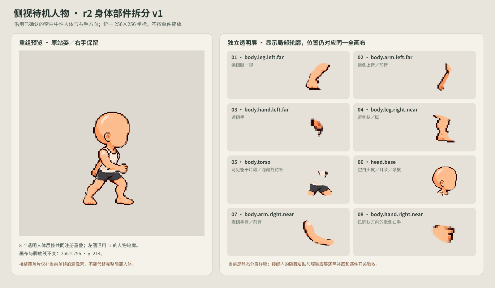

# P1 battle-side right idle · body part split v1

This is the first registered part map for the user-approved r2 neutral pose. The pose and the near/right hand direction are approved; this part package is a new review candidate and is not approved yet.

The eight separate transparent layers keep the same 256×256 canvas and the same fixed transform as [r2](../right-idle-r2/README.md). Their editable masks live in [authoring.svg](authoring.svg), and [build.sh](build.sh) regenerates the part PNGs and the review image. The parts are never alpha-fitted, individually scaled, or re-centered.

The composite keeps the approved pose and its 214px sole line. A small `coverage-fill.png` layer recovers 442 original source pixels left outside the current cut masks so the static recomposition has the complete silhouette. That layer is only a fixed-pose seam patch. It does not contain the finished hidden torso, shoulder, hip, or limb anatomy needed when parts move.

Two generated torso-piece trials are preserved in `drafts/`. Both changed the torso proportions and missed the approved source registration, so neither is used in the PNG parts. The delivered candidate instead cuts the already-approved registered r2 source. This preserves the pose, while leaving the hidden anatomy problem visible and documented for the next art pass.

## Part map

The eight pose-map layers are ordered as follows:

1. `body.leg.left.far`
2. `body.arm.left.far`
3. `body.hand.left.far`
4. `body.leg.right.near`
5. `body.torso`
6. `head.base`
7. `body.arm.right.near`
8. `body.hand.right.near`

Every PNG is a full-canvas 256×256 RGBA image. `parts.json` records the part names and their shared coordinates. The torso image shows only the visible source pixels assigned to that layer; missing pixels behind the arms and shorts have not been redrawn.

## Validation and limits

`./build.sh` exports the eight layers from the editable SVG, creates the fixed-pose coverage patch, recomposes the body, and renders `review.png`. Validation confirms all eight layers are non-empty 256×256 RGBA images and the recomposed alpha silhouette matches r2. The current visible pose is preserved; some edge colors differ where the vector masks overlap and re-composite the original antialiased pixels.

This is a static segmentation study, not a production rig or a complete common-body asset. Hidden anatomy, clothing/skin separation under the arms, moving-limb seam tests, weapon grip, other frames/directions, and runtime integration remain open. The empty-hand pose does not approve a weapon grip.
