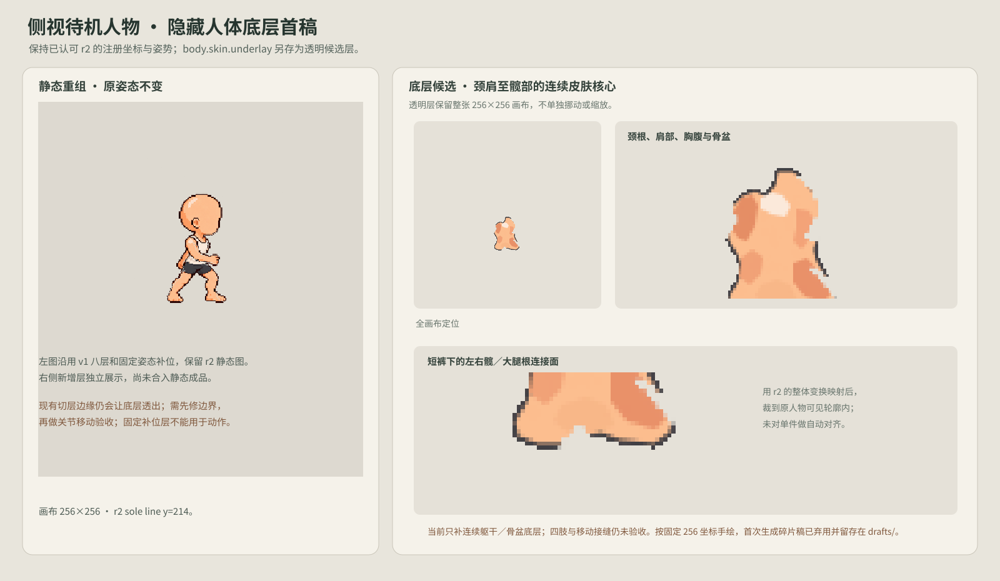

# P1 battle-side right idle · hidden anatomy first pass v2

This candidate continues the user-approved r2 neutral pose and near/right hand direction. It keeps the same 256×256 canvas, shared transform, eight part masks and static assembly as [parts-v1](../right-idle-parts-v1/README.md), and adds a separate `body.skin.underlay` anatomy study.

The editable underlayer is one connected neck, shoulder, chest, abdomen and pelvis silhouette, drawn in the same fixed 256×256 coordinates and clipped to the approved r2 silhouette. Its warm skin colors were sampled from r2; it was not shifted or fitted to its own alpha bounds. Its source geometry is in [underbody-authoring.svg](underbody-authoring.svg). An earlier generated patch attempt is preserved but unused because it broke into disconnected islands; its prompt and hash are recorded in [drafts/underbody-generation.json](drafts/underbody-generation.json), and the edit notes are in [drafts/underbody-art-notes.json](drafts/underbody-art-notes.json).

The underlayer is not yet included in `assembled.png`. Initial compositing showed it bleeding through the existing antialiased part-mask boundaries, so it would change the accepted static appearance. The review image keeps the v1 assembly intact and presents the underlayer separately. The old `coverage-fill.png` remains a review-only aid for that static assembly; it still contains no reusable anatomy.

This is a partial first pass, not a complete common-body underlayer. The torso/hip skin surface still needs more work, and no limb translation or rotation seam test has passed. Do not use the fixed-pose coverage fill for animation or runtime. Hair, face, clothing, shoes, weapons, actions, other poses/directions and runtime integration remain out of scope.

## Layers

`parts.json` records the intended stack order with `body.skin.underlay` below the original parts. The current `assembled.png` is deliberately the original v1 static composite because the existing antialiased boundaries and fixed-pose coverage patch are not ready to reveal this layer. `parts.json` marks the underlayer as incomplete and the coverage patch as non-runtime. Every PNG remains a full-canvas 256×256 transparent file.

## Rebuild and validation

Run `./build.sh` to export the anatomy layer and eight part masks, generate the review image and validate the canvas sizes, nonempty layers, r2 alpha silhouette, underlayer containment and unchanged v1 static composite. The underlayer currently contains 1,527 nontransparent pixels in a 41×54-pixel registered region. Static assembly comparison against v1 returns zero differing pixels. This is a placement check, not a moving-joint or production-art pass.

The v1 part-boundary draft and its original review remain preserved. This new candidate is still awaiting review; r2's pose approval does not extend to the underlayer.
