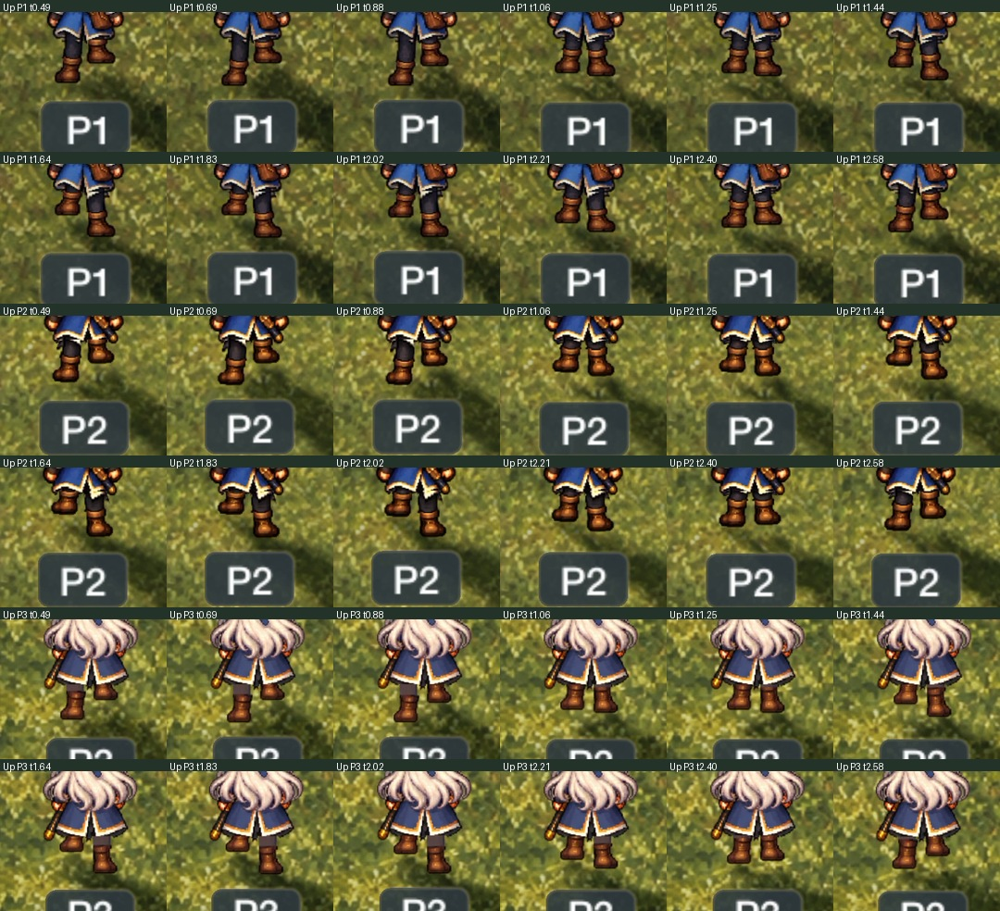
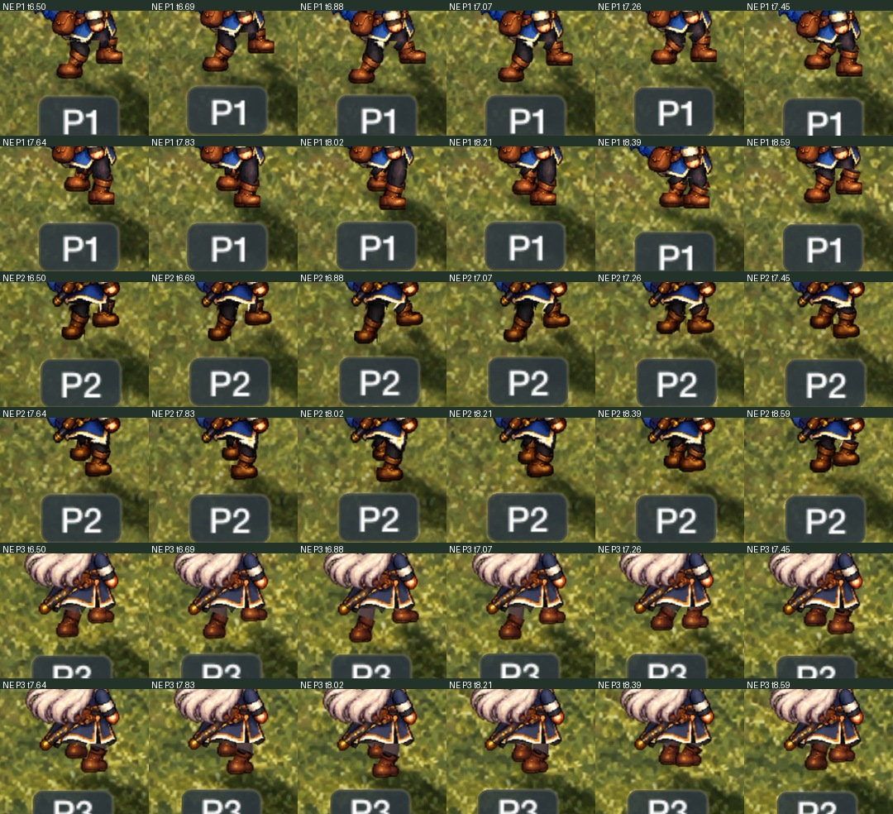
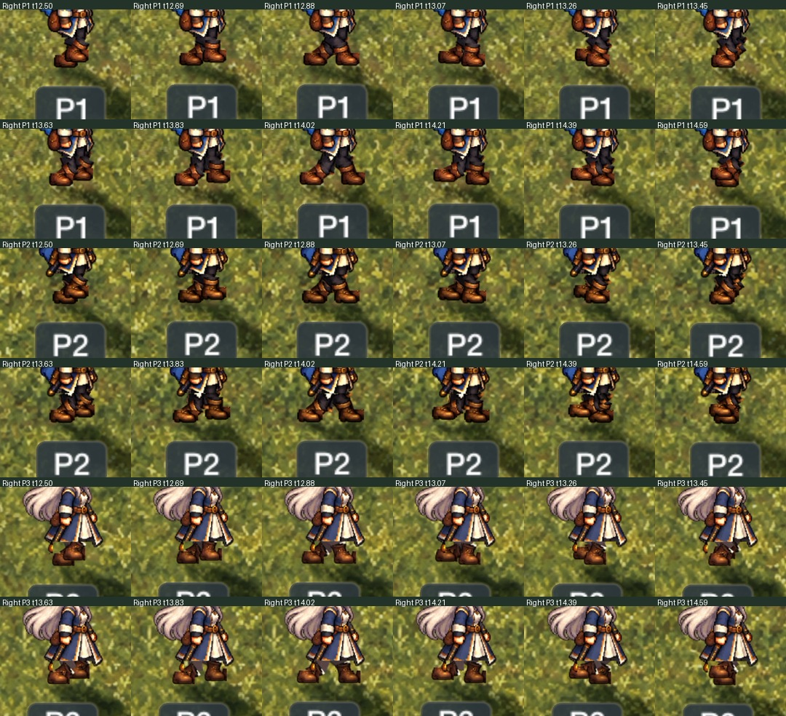
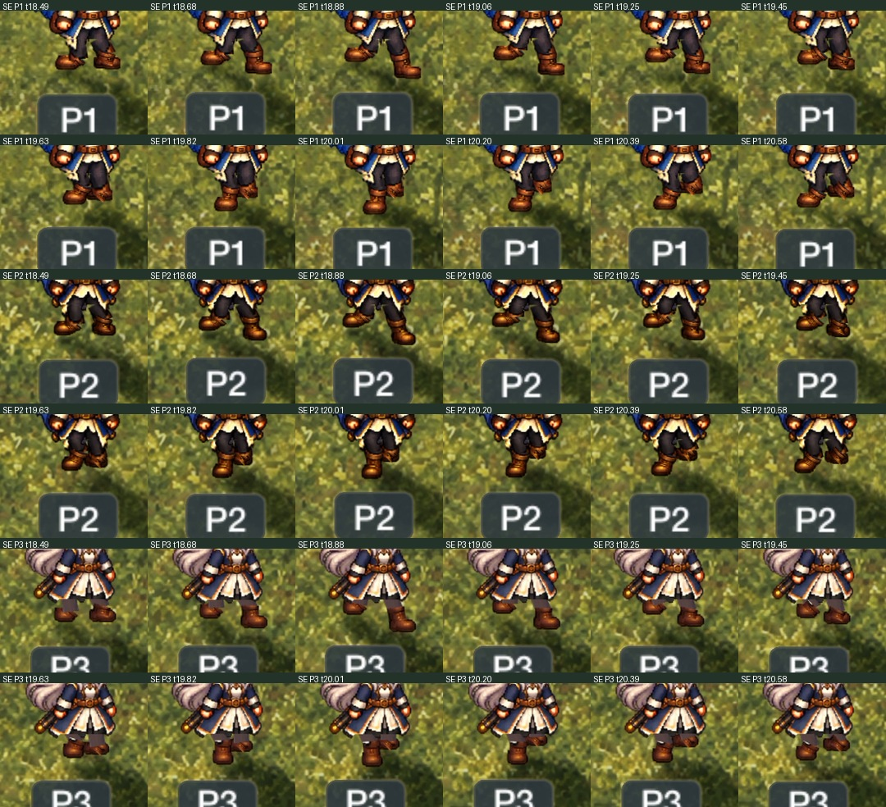
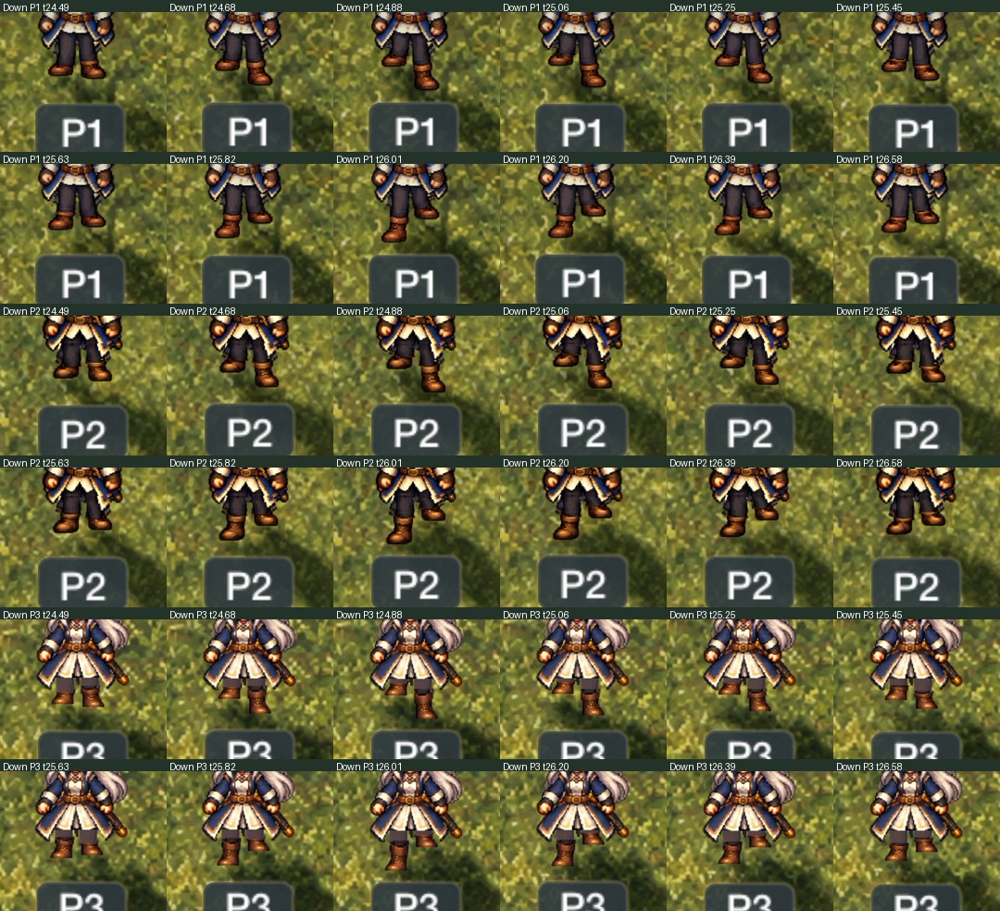
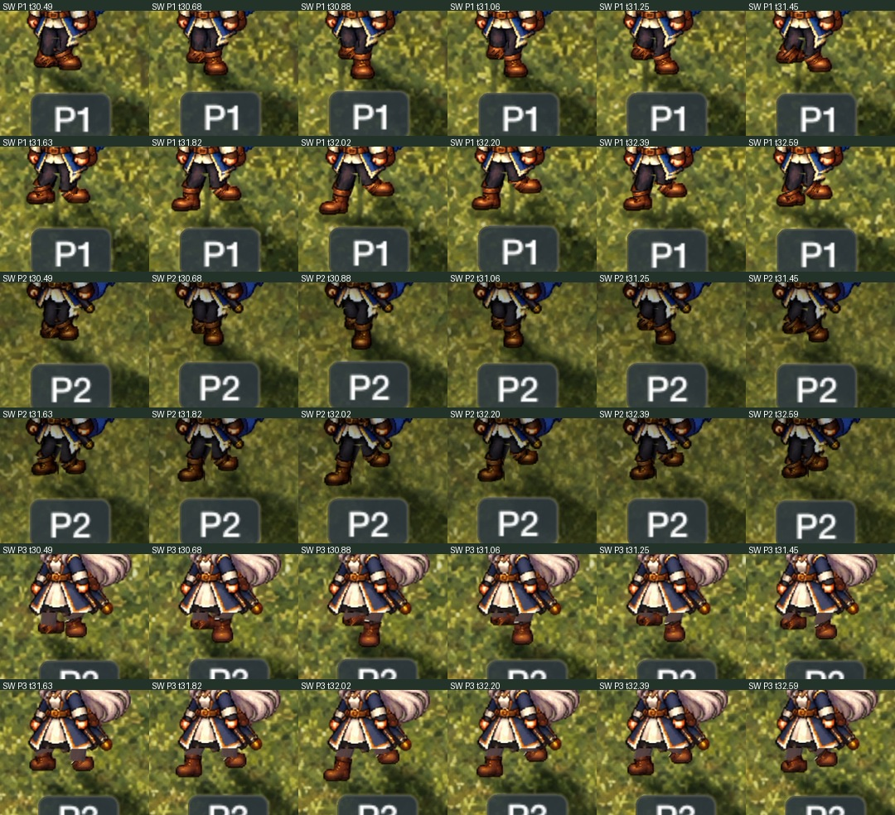
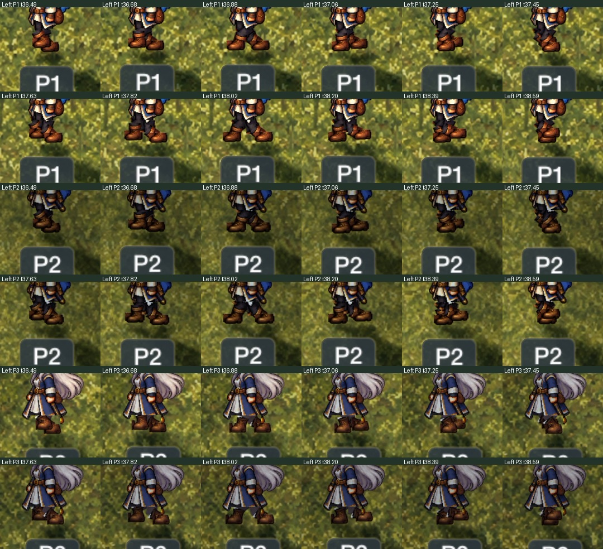
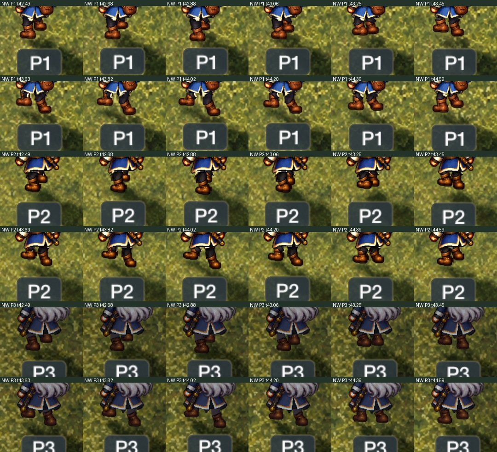

# build 26 鞋部朝向复核

[IPA 与校验信息](../../Downloads/README.md) · [正常速度录像](../iPad-Gait-Normal-b26.mp4) · [四分之一速度录像](../iPad-Gait-Quarter-b26.mp4) · [云端检查结果](CloudValidation.json) · [完整构建元数据](../../Downloads/MeadowJourney-build26.json)。

源码 `b60d8e5b7e2aab4ac80ffc607b34c4eecdca47aa` 来自[成功构建 39033438871](https://github.com/liamchan-rgb/experiment/actions/runs/39033438871)。设备 Release archive、16 项原生检查和 3 项 iPad UI 检查通过。UI 步态测试遍历八个朝向的 24 张姿势；另有三位人物、八方向、每方向 12 个时间样本的四分之一速度实景录像复核。

旧生成器把统一的水平鞋跟／鞋尖轴施加到每个方向，旋坏了原画里已画好的鞋面角度。现在鞋部作为刚性图层随踝点平移，不再旋转鞋子。以下每张图把一个方向中三位人物的连续样本排在一起，用于查看原画角度是否保持、鞋口与脚踝轮廓是否稳定。样本检查不是逐帧人工观看声明。

| 朝向 | 四分之一速度连续样本 |
| --- | --- |
| 上 |  |
| 右上 |  |
| 右 |  |
| 右下 |  |
| 下 |  |
| 左下 |  |
| 左 |  |
| 左上 |  |

正常速度录像已保留，但录屏启动时方向计时器已从“上”切换至右上，因此它不包含上方向；八方向完整展示以慢速录像和 UI 测试为准。云端使用 iPad Pro 13-inch（M4）模拟器、iOS 18.5。没有连接用户的 M1 iPad／iPadOS 27.2，也没有运行 iPhone 测试。

可换装动画的开源项目调研与接入边界见[角色骨骼方案评估](../../docs/CHARACTER_RIG_EVALUATION.md)。Rigby2D 值得做独立 iPad 原型，但当前单层角色 PNG 不能直接分成可换装部件。
